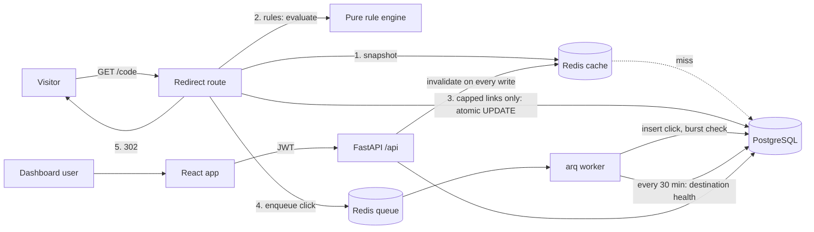

# LinkPulse

A URL shortener built around the full link lifecycle: create a link with rules, redirect visitors fast, record every click without slowing the redirect, report on it live, and take a bad link down instantly.

**Stack:** FastAPI (Python 3.12) · PostgreSQL · Redis · arq worker · React 18 + Vite · Recharts

## Live

- **Dashboard:** https://linkpulse.antideploy.app (sign in as `demo@linkpulse.dev` / `Demo@12345`)
- **API and short links:** https://lnkp.antideploy.app (interactive docs at `/docs`; try https://lnkp.antideploy.app/diwali)

Hosted on Antideploy: the API with its PostgreSQL, and the dashboard as a static site. The hosted API runs without Redis (no cache; clicks are written right after each response). How to deploy: [deploy/README.md](deploy/README.md).

---

## Quick start

### Option A: Docker (recommended, one command)

```bash
docker compose up --build
docker compose exec api python -m scripts.seed --reset   # sample links, campaigns and about 3,500 clicks
```

- App: http://localhost:5173
- API docs (interactive): http://localhost:8000/docs
- Short links: http://localhost:8000/diwali, http://localhost:8000/get-app …

### Option B: Run each part yourself

```bash
# Postgres and Redis (or point DATABASE_URL / REDIS_URL at hosted ones)
docker compose up -d db redis

cd backend
python -m venv .venv && source .venv/bin/activate     # Windows: .venv\Scripts\activate
pip install -r requirements-dev.txt
cp .env.example .env
python -m scripts.seed --reset
uvicorn app.main:app --reload                          # terminal 1
arq app.worker.WorkerSettings                          # terminal 2

cd ../frontend
npm install
npm run dev                                            # terminal 3, http://localhost:5173
```

No Redis? Set `REDIS_URL=` (empty). The app still works: no cache, and clicks are written in-process after each response instead of by the worker.

### Demo accounts (created by the seed script)

| Email | Password | Role |
|---|---|---|
| admin@linkpulse.dev | Admin@12345 | Administrator |
| demo@linkpulse.dev | Demo@12345 | Marketing user (owns most links) |
| priya@linkpulse.dev | Priya@12345 | Second user, for access-control demos |

On a fresh database with no seed, the **first account registered becomes the admin**.

---

## Architecture



The redirect path does **no database work at all** for a cached, uncapped link. Everything slow (writing the click, enrichment, burst detection) happens in the worker.

### Rule order

Implemented once, as a pure function in `backend/app/core/rules.py`. The Rule Simulator in the UI calls the same function, so it shows exactly what a visitor would get.

| # | Rule | Why it sits here |
|---|---|---|
| 1 | Link exists | Nothing to evaluate otherwise; archived links count as missing |
| 2 | Not disabled, domain not blocklisted | Safety beats everything, including expiry fallbacks |
| 3 | Not paused | Owner switched it off |
| 4 | Start time passed | Scheduled links aren't live yet |
| 5 | Not expired | May send visitors to a fallback URL instead of an error page |
| 6 | Under click limit | Fast pre-check; the real guard is the atomic increment after step 8 |
| 7 | Password accepted | After the cap check, but the click is consumed only after success, so wrong guesses never use up clicks |
| 8 | Targeting | First matching device / OS / country rule (by priority) wins; otherwise the main destination |

### Data model

```
User 1─* Link *─1 Campaign
         Link *─* Tag
         Link 1─* TargetRule     (device / os / country → destination)
         Link 1─* ClickEvent     (every visit attempt, with outcome)
BlockedDomain, AuditLog          (governance)
```

Links are never hard-deleted. "Archive" changes the status, so expired, disabled and archived links stay in every report.

---

## Design decisions (and the trade-offs)

These are the questions judges are likely to ask. Every team member should be able to answer them.

**Short codes are case-insensitive.** Everything is stored and looked up in lowercase, so `/Promo` and `/promo` can never be two different links. Generated codes are 7 characters from `0-9a-z` (about 78 billion combinations), made with `secrets` so they can't be guessed. Uniqueness is enforced by a database unique index; on a collision we retry inside a savepoint.

**302, not 301.** Browsers cache 301 redirects permanently. Repeat visitors would never reach us, so their clicks would go uncounted, and an admin takedown wouldn't stop them. Every redirect also sends `Cache-Control: no-store`.

**Click caps are exact under concurrency.** The cap is enforced with a single `UPDATE … SET click_count = click_count + 1 WHERE click_count < click_cap RETURNING …`. The database does the check and the increment together. "Read the count in Python, then update" lets two simultaneous visitors both take the last click. `scripts/cap_race.py` proves this live.

**Bots never count, and can't bypass caps.** Link-preview fetchers (WhatsApp, Slack, Telegram…) request a link the moment it's pasted into a chat. Counting them inflates clicks and can use up a cap before any human clicks. Bots are still logged, with a reason, so the filter is transparent. On **capped** links, bots get a title card instead of a redirect. Otherwise anyone could bypass a cap by sending a "WhatsApp" user agent.

**Async click logging with a fallback.** The redirect enqueues a small event and returns. If Redis is down, the event is written by a FastAPI background task after the response instead. The redirect never fails because analytics are unavailable.

**Instant takedowns.** Every write to a link deletes its cache entry. Blocklisting a domain affects existing links on the very next visit, because the redirect checks the destination's domain (and its parent domains) against a Redis set.

**Privacy-preserving unique visitors.** We store `HMAC(secret, day | ip | user agent)`, never the IP. Because the day is part of the input, a visitor can't be tracked across days. Trade-off: "unique visitors" over a range counts distinct visitor-days.

**SSRF protection.** When the server checks whether a destination is reachable, it first resolves the hostname and refuses private, loopback and cloud-metadata addresses, and it never follows redirects. Destinations like `http://localhost`, `http://169.254.169.254`, `javascript:` and `user@host` tricks are rejected outright.

**Access control returns 404, not 403.** A user requesting another user's link ID gets the same response as a link that doesn't exist, so IDs can't be probed. This is covered by `tests/test_api.py::test_users_cannot_see_each_others_links`.

**Validation before publishing.** Step 1 of the wizard calls `POST /api/links/validate`, which returns **errors** (block publishing: invalid URL, duplicate or reserved alias, blocklisted domain, Safe Browsing hit) and **warnings** (shown for review: http instead of https, unreachable page, look-alike domain). The same checks run again on create, because the client can't be trusted.

---

## Feature map (brief → implementation)

| Brief | Where |
|---|---|
| Auto or custom aliases, expiry, password | `core/codes.py`, wizard `pages/NewLink.jsx` |
| Redirect rules: status, expiry, click limit, device targeting | `core/rules.py`, `routers/redirect.py` |
| Click tracking: time, referrer, device, browser, location | `services/clicks.py`, `core/agents.py`, `services/geo.py` |
| Campaigns and tags | `routers/campaigns.py`, `pages/Campaigns.jsx` |
| QR codes with scan tracking | `services/qr.py` (encodes `?src=qr`) |
| Bulk CSV import with error and duplicate detection | `services/importer.py`, `pages/Import.jsx` |
| Live dashboard: KPIs, campaigns, top links, alerts | `services/analytics.py`, `components/Report.jsx` |
| Roles: visitor, user, admin | `security.py` |
| Admin disable, domain blocklist, audit log | `routers/admin.py`, `pages/Admin.jsx` |
| Rate limiting on link creation | `ratelimit.py` (Redis-backed, shared across instances) |

Beyond the brief:

- **Rule Simulator:** pick a device, OS, country and time, and see each rule pass or fail in order.
- **Destination health checks:** the worker checks active links every 30 minutes and raises "broken destination" alerts.
- **Abuse signals:** alerts for disabled links still receiving traffic, password guessing, traffic spikes and bot-heavy links.
- **Expired-link fallback URL**, **scheduled links** and **campaign UTM defaults**. These feature ideas were inspired by Dub (dub.co); no Dub code is used.
- **Optional Google Safe Browsing** check at creation (set `SAFE_BROWSING_API_KEY`).

---

## Tests

```bash
cd backend
python -m unittest tests.test_rules tests.test_core   # pure logic; no packages or services needed
pytest -q                                             # everything, including API tests on SQLite
```

The API tests cover: case-insensitive aliases, bots not counted, IDOR, validation errors and warnings, **exact click caps under concurrency**, bots unable to use or bypass caps, the password flow, admin disable taking effect immediately while keeping analytics, blocklisting existing links, expiry fallback with OS targeting, the simulator, CSV preview and commit, and the dashboard.

### Performance proof

```bash
python -m scripts.cap_race --cap 100 --requests 1000 --concurrency 200
locust -f loadtest/locustfile.py --host http://localhost:8000 -u 200 -r 50 -t 1m --headless
```

`cap_race` prints p50/p95/p99 redirect latency and checks that exactly 100 of 1,000 simultaneous visits were redirected. Put the real numbers from your machine in your slides.

---

## Five-minute demo script

**Scenario 1: link creation to analytics (about 2.5 minutes)**

1. Sign in as `demo@linkpulse.dev`. The dashboard shows live numbers and alerts, including `/festive-drop` spiking and `/early-bird` near its cap.
2. Create a link: type an alias that already exists (`diwali`) to show the error, then `http://` to show the warning. Fix them, add the Diwali campaign (UTM fills in), set a click limit and an iPhone rule, and publish. Show the QR code.
3. Open the link on a phone (QR) and on a laptop: they go to different places. Paste it into WhatsApp or Slack, then show under **Recent visits** that the preview fetch was filtered as a bot.
4. Open the **Rule simulator** and change the device and time to show each rule firing.

**Scenario 2: bulk import to takedown (about 2.5 minutes)**

1. Import a CSV containing a duplicate alias, a taken alias and a `javascript:` URL. Each row's problem is shown, and only valid rows are imported.
2. Sign in as admin. **Admin → Moderation** shows `/claim-reward` (disabled) still receiving traffic.
3. Block a domain used by one of the imported links, then open that link: it stops immediately. Its analytics are still there.
4. Run `scripts/cap_race.py` in a terminal: 1,000 concurrent requests, exactly 100 redirected.

---

## Deploying (Render or Railway)

1. Create **PostgreSQL** and **Redis** (Key Value on Render) services.
2. **API** web service from `backend/` using the Dockerfile. Set `DATABASE_URL`, `REDIS_URL`, `SECRET_KEY` (long and random), `BASE_URL` (the API's public URL), `FRONTEND_URL`, and `TRUST_PROXY_HEADERS=true`.
3. **Worker** service from the same image with command `arq app.worker.WorkerSettings` and the same environment.
4. **Frontend** as a static site from `frontend/` (`npm install && npm run build`, publish `dist`, with a rewrite of all paths to `/index.html`) and `VITE_API_URL` set to the API URL.
5. Run `python -m scripts.seed --reset` once from the API service shell.

The app refuses to start with the default `SECRET_KEY` unless `BASE_URL` is localhost. Check each provider's current free-tier limits before you rely on them.

---

## Known limitations (stated honestly)

- **Schema migrations:** tables are created on startup (`AUTO_CREATE_TABLES`). Move to Alembic once the schema stops changing.
- **Unique visitors** are counted per day (see the privacy note above).
- **Burst detection runs in the worker**, after a capped link's click was already counted. Such clicks are still flagged as bots in analytics.
- **Health checks** resolve DNS, then fetch. A DNS-rebinding attacker could change the answer in between. Pinning the resolved IP would close this.
- **Link list filters by effective status in Python.** This is fine up to tens of thousands of links; beyond that, move it into SQL.
- **Without Redis**, rate limits are per process and there is no cache.
- **Tokens are stored in localStorage.** This is simple, but readable by any XSS on the frontend. httpOnly cookies are the hardening step.
- **Workspaces and folders** from the brief are not implemented. Campaigns and tags cover organization.
- **Country data** needs CDN headers (Cloudflare, Vercel) or a MaxMind GeoLite2 file (`GEOIP_DB_PATH`). Otherwise it shows "Unknown".

## Roadmap

1. Custom domains per workspace (`go.brand.com/x`)
2. Workspaces with team roles
3. Public API with personal access tokens and webhooks on click thresholds
4. A/B split destinations with a significance test
5. Click aggregation tables (hourly rollups) for large datasets
6. Alembic migrations and httpOnly-cookie sessions

## Log in Page:


## Dashboard:


## Links:


## Campaigns:


